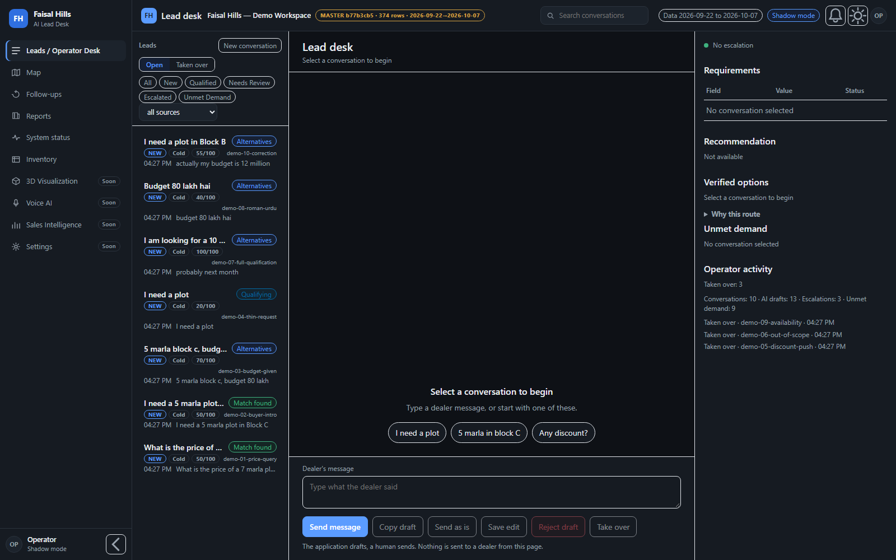
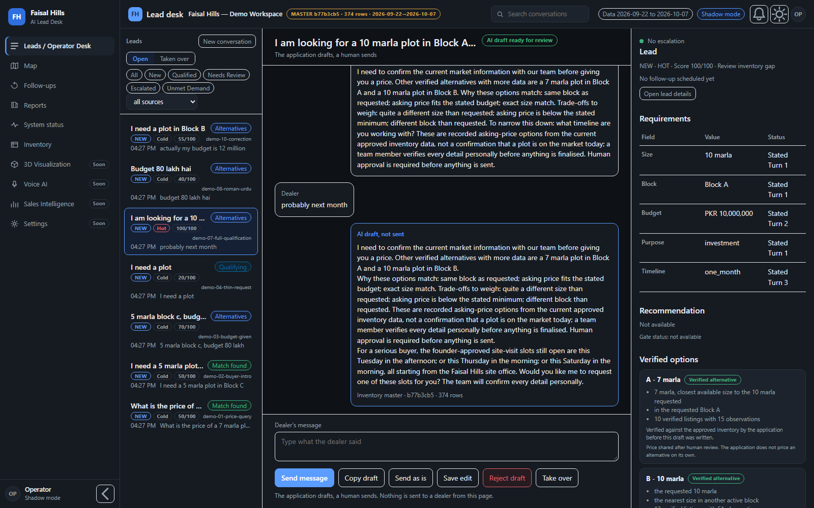
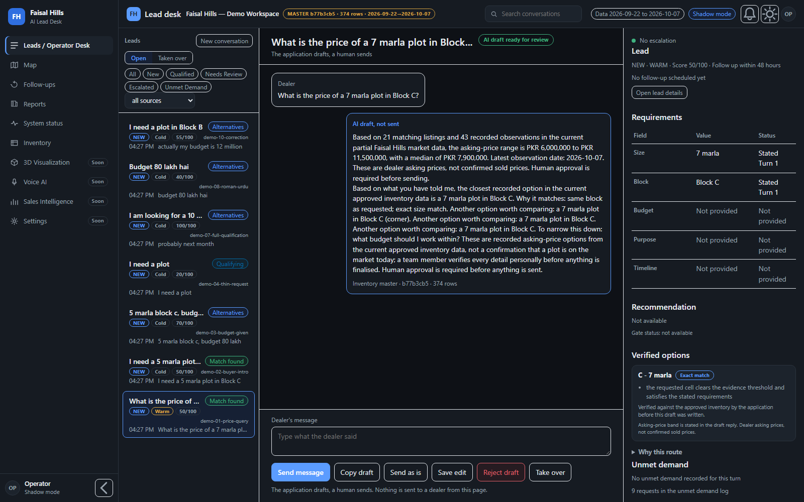
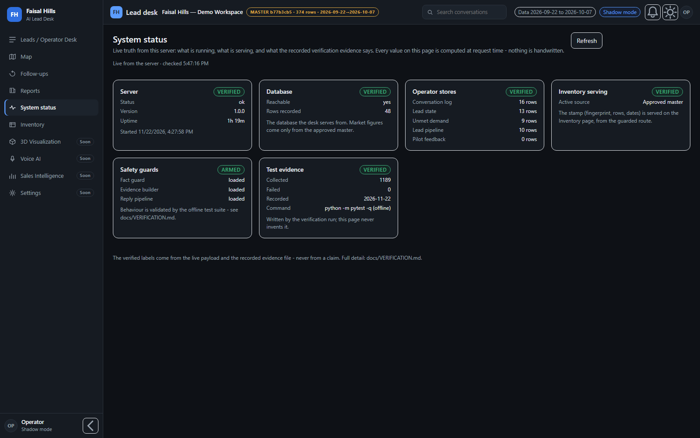
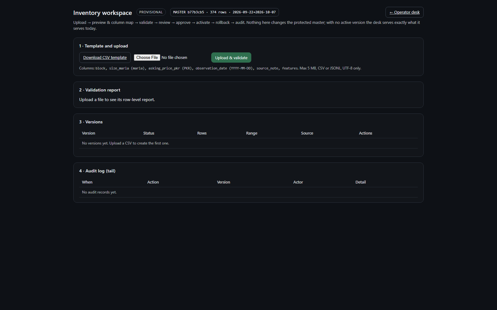
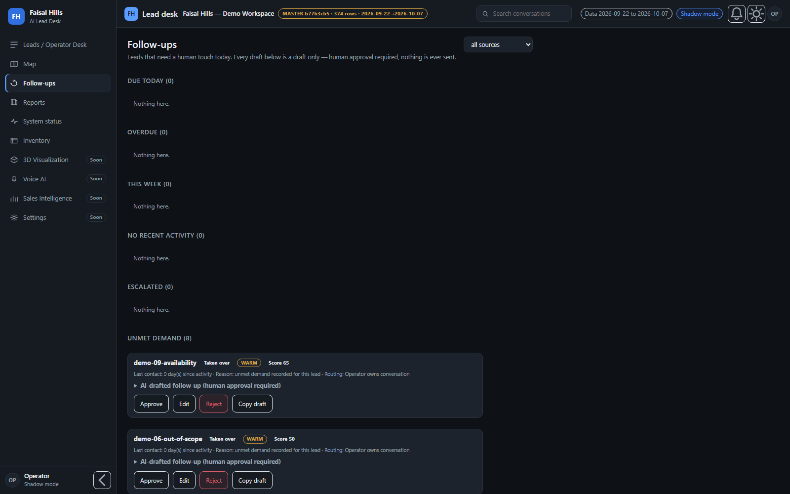
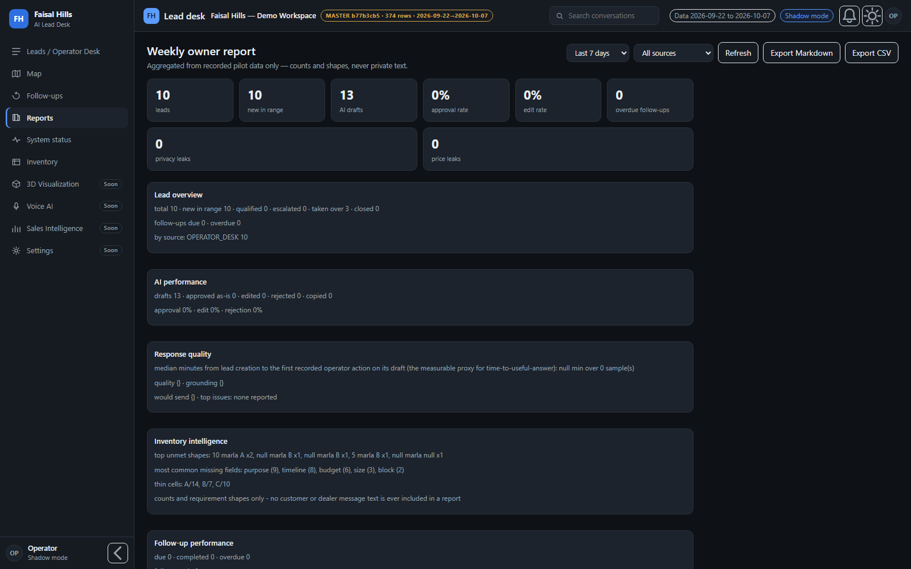

# Faisal Hills AI Lead Desk

An operator-first lead desk for the Faisal Hills housing society (near Taxila,
on the GT Road N-5 corridor). Dealers' WhatsApp-style questions are qualified,
answered **only** from an approved master inventory, and every customer-facing
reply is drafted for **human approval** — nothing is ever sent automatically.



## Why this project is different

Most demo chatbots invent numbers. This one is built so it **cannot**:

- **Approved-master-only answers** — prices, availability and observations
  come from one fingerprinted, versioned master inventory. The desk shows the
  fingerprint, row count and observation-date range it is serving on every
  page (`MASTER b77b3cb5 · 374 rows · 2026-09-22→2026-10-07`).
- **Fact guard + claim guard + traceability** — before a draft reaches the
  operator, every number and claim in it is traced back to the approved
  master. A number that does not trace is detached and the turn is escalated
  to a human. A surface-completeness test walks every API route and proves
  each one is guarded.
- **Human-in-the-loop by construction** — the application drafts, a human
  sends. The composer says so permanently; no send capability exists.
- **Privacy by design** — no dealer names, phones or private text are served
  by the operator surfaces. Dealer words appear only as the previews the
  operator already sees in the thread.
- **Offline and dependency-free** — the core runtime is Python stdlib +
  SQLite. No LLM API key, no cloud call, no paid provider. The test suite is
  fully offline.

## Screenshots

| | |
|---|---|
|  |  |
| Qualification over three turns (size → budget → timeline) | Exact-match price query; every figure traced to the master |
|  |  |
| Live system status with per-component verified labels | Versioned inventory: upload → validate → review → activate → rollback |
|  |  |
| Follow-up queue — drafts only, human sends | Weekly owner report (counts and shapes, never private text) |

Also included: an offline location map (bundled Leaflet + local tiles, no
network), a lead pipeline with stages/scores/site-visit requests, an unmet
demand log, and pilot feedback capture.

## Architecture

```
Dealer message
      │
      ▼
┌──────────────────────────────────────────────────────────────┐
│ turn pipeline (app/turn_pipeline.py)                          │
│   normalise → qualify → policy route → price lookup           │
│   → fact guard → claim guard → draft reply                    │
└──────┬───────────────────────┬───────────────────────────────┘
       │                       │
       ▼                       ▼
┌──────────────┐        ┌──────────────────┐
│ market/*     │        │ operator desk UI │
│ approved     │        │ (app/static —    │
│ master only: │        │  plain HTML/CSS/ │
│ price_lookup │        │  JS, no build    │
│ fact_guard   │        │  step)           │
│ evidence,    │        └──────────────────┘
│ recommend …  │
└──────────────┘
       │
       ▼
 SQLite stores: conversation log · lead state · lead pipeline ·
 unmet demand · pilot feedback · demo fact DB (all isolated files)
```

Key modules:

| Layer | Module | Responsibility |
|---|---|---|
| Console | `app/server.py` | FastAPI surface (~50 routes), guard-checked per route |
| Turn | `app/turn_pipeline.py` | One dealer turn end-to-end; produces the draft |
| Policy | `app/policy.py`, `app/policy_extra.py` | Route decision: exact / alternative / clarify / escalate |
| Facts | `market/fh_query.py`, `market/price_lookup.py` | Approved-master lookups with observation counts |
| Guards | `market/fact_guard.py`, `market/fact_validator.py` | Every served number must trace to the master |
| Evidence | `market/evidence.py`, `market/recommend.py` | Matching rows and ranked verified alternatives |
| Persistence | `market/conversation_log.py`, `market/lead_state.py`, `market/lead_pipeline.py` | Replayable record of every turn and operator action |
| Inventory | `market/inventory_workspace.py` | Versioned inventory lifecycle with audit trail |
| Data | `data/db.py`, `data/schema.sql`, `data/demo_seed.py` | Demo fact database (seeded, idempotent) |

## Quick start (Windows)

```powershell
cd D:\AI-Projects\laya-gateway

# 1. project-local virtual environment
python -m venv .venv
.\.venv\Scripts\python.exe -m pip install -r requirements.txt

# 2. seed the demo fact database (idempotent)
.\.venv\Scripts\python.exe -m data.demo_seed

# 3. one-click start (server on 127.0.0.1:8080 + browser)
.\start_operator_desk.bat
```

Then open `http://127.0.0.1:8080/operator`.

- The desk serves the **approved master** pointed to by `FH_MASTER_PATH`
  (defaults to the owner machine's path; point it at your own master file to
  run elsewhere). The served fingerprint is shown in the page header.
- Optional HTTP basic auth: set `CONSOLE_PASSWORD` (user `admin`).
- Reset the demo desk to its curated state at any time:
  `.\.venv\Scripts\python.exe tools\reset_demo_state.py` (backs up first).
- Live truth about the running server: `http://127.0.0.1:8080/api/system-status`
  and the **System status** view in the sidebar.

## Tests

```powershell
.\.venv\Scripts\python.exe -m pytest -q
```

The suite is fully offline: no API keys, no Llama/llama.cpp/Ollama calls, no
paid provider. It runs against local mocks and the approved master. The
current count and date are recorded in
`evaluation/reports/system_status_evidence.json` and shown live on the
**System status** view. Highlights:

- `tests/test_m5_surface_completeness.py` — walks **every** API route and
  proves each serving surface is covered by a guard (this is the check that
  proves no surface can serve an untraceable number).
- `tests/test_m11_operator_page_request.py` — the page's own request path,
  read out of the page's JavaScript, asserted end-to-end.
- `tests/test_m12_2_persistence.py` — the transcript replays exactly what
  was served, including the verified options of each turn.
- `tests/test_system_status.py` — the status surface carries infrastructure
  truth only (no market figures, no private fields, true counts).

## Documentation

- `docs/PROJECT_OVERVIEW.md` — the one-page story for evaluators.
- `docs/VERIFICATION.md` — the verification matrix: every component, its
  evidence, and the date it was verified.
- `docs/UPLOAD_GUIDE.md` — how to package and submit this project to
  evaluation platforms, including what is deliberately excluded.
- `docs/DEMO_SCRIPT.md`, `docs/BACKUP_POLICY.md`, `docs/m12_api_contract.json`.

## Status

Production pilot on the owner machine; 1,000+ offline tests passing; no open
critical defects. Planned modules (marked "Soon" in the UI): 3D visualization,
voice intake, sales intelligence, settings.
